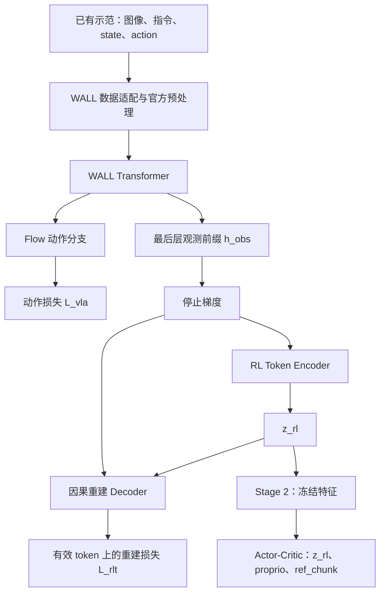

# WALL-OSS-0.5＋RLT：具体实施方案

更新：2026-10-29。当前项目状态统一见 [PROJECT_STATUS.md](PROJECT_STATUS.md)。本文记录已实现的技术方案和仍需执行的 GPU／完整模型验收计划；原 H100 远程推理与重新采集路线不再执行。

## 1. 目标、分工与证据状态

截至 2026-10-29，**目标数据适配、Stage 1 训练／恢复接口、Stage 2 单步合成检查、推理导出／服务／回放及离线构建工具已实现；三份候选包均已在 My Passport 上 READY**。最新 [CPU 汇总报告](logs/rlt-inference-20261029/cpu-check/report.json) 为 **377 项 PASS，0 失败／错误／跳过**，另有源码锁、训练入口预检及合成 Stage 2 检查 PASS。

官方 WALL 权重可用；项目尚无训练后的 Stage 1 WALL＋Encoder 或 RL Actor 权重。5070 Ti 派生镜像构建、目标 GPU 内核、完整官方 WALL／WALL＋RLT 推理、H100 训练均记录为 **NOT_RUN，尚无对应目标机验收报告**。这些状态描述现有项目证据；未收到用户的拷贝／上传完成回执，不推断其线下进度。最终 WALL-RLT 产品未封版。

| 工作 | 已确认约定与现有边界 |
|---|---|
| 数据 | 使用已有 `top_error` 七类 350 条抓取轨迹，排除 mouse／tape，忽略历史验证集；字段、时间对齐、划分、normalizer 与代表 batch 已 CPU 核验；不采集新数据 |
| 训练 | 用户确认服务器共有 8 张 H100；单卡显存和实际作业分配尚未实测；现有双卡 FSDP 候选保持不变，本机不连接 H100 |
| 推理目标 | Ubuntu `crp-5070ti-01`，RTX 5070 Ti 16GB／16303 MiB，驱动 595.91.07，目录 `/home/crp-5070ti-01/yuhang_workspace/wall_oss_rlt` |
| 部署执行 | 用户通过 My Passport 拷贝，在目标机自行离线构建 `sm_120` 并验证；本机不通过 SSH 部署，操作见 [部署说明](WALL_RLT_Inference_Deployment.md) |
| 模型输出 | 已实现 WALL＋Encoder 推理，返回物理空间 `32×8` WALL 参考动作及可选 `z_rl`；不含 Actor／Decoder，不执行机器人 |
| 在线 RLT | 目前只有 C=1 单步 synthetic CPU 更新证据；没有真实奖励 replay、在线训练或收益验收 |

真实微型 WALL 的 RGB 前向、选择性 BF16／FP32 权重恢复、固定 seed 和 HTTP 往返已在 CPU 验证；完整底座与 GPU 证据另列。技术解释见 [详细实现审阅](WALL_RLT_Implementation_Review.md)。

| READY 交付包 | 字节数 | 包含内容 |
|---|---:|---|
| `WALL-OSS-CRP-transfer-20261029` | 16,787,299,846 | D0 基础环境、官方模型、历史验证数据 |
| `WALL-RLT-training-candidate-20261029-v1` | 5,781,431,598 | 固定训练源码、44 个 wheel、350 条目标轨迹 |
| `WALL-RLT-inference5070-20261029-v1` | 10,979,923 | 8 个文件、6,888 个源码成员，目标机离线构建与推理工具 |

三包合计 **45 文件、22,579,711,367 字节**，不计包外说明。旧 D0＋训练候选两包的小计仍为 **37 文件、22,568,731,444 字节**；原 [H100 中转说明](</media/pangk/My Passport/WALL-H100-中转说明-20261029.txt>) 与 [旧两包 SHA256 清单](</media/pangk/My Passport/WALL-H100-SHA256SUMS-20261029.txt>) 保留其原范围。新包整包校验、实际解包及 portable 入口 PASS，见 [推理交付记录](metadata/rlt-inference-deployment-20261029.json)。包内部不随工作区文档更新而改写。

D0 的构建机组件、历史数据、`sm_90` 架构及整包校验见 [基础交付报告](logs/server-environment-delivery-20261029.json) 和 [组件验收](logs/docker-validation-delivery-20261029/)。基础包仍有 11 项已知依赖声明问题，`pip check` 为 FAIL；不能据此认定训练或 5070 Ti 环境完整通过。旧 `WALL-OSS-CRP-transfer-20261028` 为 INCOMPLETE，不可部署。

H100 的用户中转链路仍为“本机 → My Passport → 用户电脑 → 专用网线 → H100”。历史网络约定网关 `10.241.245.6`、Windows 只中转，详见 [H100 使用说明](H100使用说明.md)；不把这些网络参数套用于另一台推理主机，也不把历史 SSH 超时当成重新连接任务。

## 2. 固定源码与已核实的接入点

| 来源 | 本次核对基准 | 状态 |
|---|---|---|
| Wall-X | `ce2a1ae31d9ee1028b97ca40e3f66034cf8c0e5f` | 已核对本地源码；跟踪源码无修改，已有未跟踪 CUDA 构建产物 |
| WALL-OSS-0.5 | `b7dc23a82dbf70a65859c9fdd596703234597028` | 官方权重与 processor 已可用；完整底座前向未验收，已验证的模型前向为随机微型 fixture |
| RLinf | `e1a82ebf0c1af69da6ab9b1519f5f3692fe33566` | 固定源码位于 `.cache/rlinf-rlt`；原归档与 2,228 项源码内容经锁文件验证，隔离测试环境通过 PYTHONPATH 接入；H100 依赖仍需核验 |

2026-10-28 静态源码审计快照见 [wall-rlt-design-audit-20261028.json](metadata/wall-rlt-design-audit-20261028.json)。以下为已确认的代码事实及对应设计决定：

| 核实结果 | 实施决定 |
|---|---|
| WALL `forward()` 未传 `mode` 时进入 `torch.no_grad()` | Stage 1 明确调用 `wall(mode="train", ...)`，并检查动作分支梯度 |
| WALL checkpoint 的 `hidden_size=2048`，`action_hidden_size=1024` | RLT 读取观测前缀的 2048 维表示；不能误取动作专家的 1024 维表示 |
| WALL `mot_opt` 路径不支持 `output_hidden_states=True` | 在恢复 token 原顺序后的最后层输出处增加可选前缀返回，不要求返回所有层 hidden states |
| WALL LeRobot `PreprocessedDataset` 没有把源数据的 action padding 标记交给 collator | 扩展项目数据适配层，将真实时间有效性传入已有 `flow_loss_mask` |
| WALL collator 已处理归一化与维度 padding；flow 预测结果已有反归一化步骤 | 沿用官方变换，额外定义模型空间与 RL 动作空间的映射；避免重复归一化 |
| RLinf 的 `RLTTokenTransformer` 对前缀 detach，并使用因果 decoder 重建 | 直接复用该模块；RLT 重建损失不反向更新 WALL |
| RLinf `FSDPVlaSftWorker` 的数据 loader 按模型类型分支，默认验证函数未实现 | 使用项目 worker 子类，补 WALL loader、验证与恢复语义 |
| RLinf 支持 `register_model()` 与 `RLINF_EXT_MODULE` | 使用项目外部扩展注册，不把社区 PPO 代码整体移入 |
| RLinf RLT Actor 使用 `tanh` 输出，critic target 的折扣长度取 reward 张量宽度 | 固定 RL 动作空间；首轮 Stage 2 检查使用单步 transition，避免把 padding 当执行步数 |
| RLinf `embodied` extra 要求 Transformers `<=4.57.6`，本地 WALL 为 `5.2.0` | 独立求解训练依赖，不直接运行完整 OpenPI 安装流程覆盖 WALL 环境 |

来源：[WALL 模型](wall-x/wall_x/model/qact/qwen2_5/modeling_qwen2_5_vl_act.py)、[WALL 数据 loader](wall-x/wall_x/data/backends/lerobot/loader.py)、[RLinf Token 模块](https://github.com/RLinf/RLinf/blob/e1a82ebf0c1af69da6ab9b1519f5f3692fe33566/rlinf/models/embodiment/modules/rlt_token_transformer.py)、[RLinf SFT worker](https://github.com/RLinf/RLinf/blob/e1a82ebf0c1af69da6ab9b1519f5f3692fe33566/rlinf/workers/sft/fsdp_vla_sft_worker.py)、[RLinf 依赖声明](https://github.com/RLinf/RLinf/blob/e1a82ebf0c1af69da6ab9b1519f5f3692fe33566/pyproject.toml)。

## 3. 模型结构与损失



Stage 1 使用 RLinf 的组合形式：

```text
L_total = L_rlt + alpha × L_vla
alpha 初值 = 1.0
L_rlt = masked_MSE(reconstructed_prefix, stop_gradient(h_obs))
```

首版选连续 flow 动作任务，关闭 FAST／子任务文本生成训练；`L_vla` 使用 WALL 已有 flow loss。显式设 `ar_loss_weight=0` 并核对最终 loss，不能假定默认 prompt 没有文本标签。训练时为无文本监督提供正确形状的全 `-100` labels，避免 `labels=None` 触发全词表 logits 路径；验证使用独立的 loss-only 路径。

设计的梯度分工如下；Stage 1 已有 CPU 微型证据，Stage 2 的真实权重学习仍属后续范围：

| 损失／阶段 | WALL | RLT Encoder | RLT Decoder | Actor／Critic |
|---|---|---|---|---|
| Stage 1 `L_vla` | 更新选定可训练参数 | 不更新 | 不更新 | 不参与 |
| Stage 1 `L_rlt` | 不更新 | 更新 | 更新 | 不参与 |
| Stage 2 | 冻结 | 冻结 | 不参与前向 | 更新 |

Stage 1 先按 WALL 全参微调设计，另加 RLT 参数；若 H100 实际资源不足，先评估已分配多卡的 FSDP。LoRA、只训动作专家或缩小 RLT 均作为有独立配置和结果的变体，不静默替代基线。

## 4. 已有数据到训练 batch

### 4.1 冻结数据契约

2026-10-29 已按用户提供的 [数据集格式说明](数据集格式说明.md) 落实抓取数据接入。用户确认这批数据采自后续 Ubuntu 推理验证主机、使用同一机械臂；无需另找采集环境。目标为 `/media/pangk/My Passport/top_error`，**排除 `mouse`、`tape`，忽略历史验证集**。原始文件保持只读。

| 已落实项 | 当前结果 |
|---|---|
| 数据范围 | banana、black_box、black_sleeve、charger、long_box、pill_box、water_bottle，各 50 条；共 350 条、176,523 原始帧 |
| 数据核验 | 所选全部 NPZ 数值字段、700 个视频的容器帧数／FPS／首帧解码，以及 SO(3) 左乘增量、夹爪二值、腕部时间轴等核验 PASS；未做所有视频逐帧解码／内容哈希或抓取质量标注 |
| 划分 | 按物体分层、固定 seed=20261029；每类 35/7/8 条，train/dev/test 共 245/49/56 条；轨迹不跨集合 |
| 目标 | 首版 `ar5_joint_next_v1`：观测 `state[t]` + 同帧图像，监督 `state[t+1,:7]` + `action[t+1,6]`；学的是下一帧实测关节角，原始关节指令未保存 |
| 末帧与窗口 | 每条最后一帧没有未来标签，从监督观测中去掉；共 176,173 个可用观测；32 步窗口不跨轨迹，尾部补齐标为无效，不能把重复末值当真值 |
| 夹爪／常数关节 | 动作取二值开合指令，状态保留实测开度；保留全部七轴，j3/j5 常数维沿用官方零范围保护 |
| 归一化 | 仅 train 的 123,263 个对齐观测／目标计算 q01/q99；与目标版本、精确 train 清单、manifest SHA256 绑定；不使用旧 7 维原始增量统计训练 joint8 |
| 模型适配 | 明确命名 `ar5_joint8_reinit_v1`：26 维前 8 槽重新定义为七关节＋夹爪，剩余槽 mask；不是原预训练末端位姿语义。新迁移训练加载底座后须重初始化 `action_preprocessor.w1.weight` 与 `action_preprocessor.action_proj_back.weight`，恢复时不得重置；state 使用字符串表示 |
| CPU batch | 每类代表轨迹首个及最后一个监督观测，共 14 个真实样本；官方 processor 输出 `[2,32,26]`，时间／维度 mask、常数维、无效标签扰动和 collator RNG 恢复检查 PASS；未加载模型权重 |

冻结产物：[目标数据契约](configs/rlt/top_error_ar5_joint_next_v1.json)、[模型适配覆盖配置](configs/rlt/ar5_joint8_model_overrides.json)、[轨迹与划分清单](metadata/rlt-top-error-selected-20261029/episodes.json)、[对齐目标统计](metadata/rlt-top-error-selected-20261029/normalization.ar5_joint_next_v1.json)、[数据审计](metadata/rlt-top-error-selected-20261029/audit.json)、[CPU batch 报告](metadata/rlt-top-error-selected-20261029/cpu-batch.json)、[测试结果](logs/rlt-data-tests-20261029.log)。此前 `metadata/rlt-top-error-20261029/` 包含废数据的初步清单已被此版本取代，不用于训练。

以下为 2026-10-29 数据准备时的命令留存（项目根目录、独立 `.venv-rlt`）。产物已生成；再次运行须改用新的审计／契约输出目录，保留原证据，不修改 READY 包：

```bash
CUDA_VISIBLE_DEVICES='' OMP_NUM_THREADS=1 .venv-rlt/bin/python -m wall_rlt.data.audit \
  --root '/media/pangk/My Passport/top_error' \
  --output metadata/rlt-top-error-selected-20261029 \
  --exclude-group mouse --exclude-group tape

CUDA_VISIBLE_DEVICES='' OMP_NUM_THREADS=1 .venv-rlt/bin/python -m wall_rlt.data.prepare_ar5 \
  --root '/media/pangk/My Passport/top_error' \
  --audit-dir metadata/rlt-top-error-selected-20261029 \
  --document 数据集格式说明.md --contract-path configs/rlt/top_error_ar5_joint_next_v1.json

CUDA_VISIBLE_DEVICES='' OMP_NUM_THREADS=1 HF_HUB_OFFLINE=1 \
  PYTHONPATH="$PWD/wall-x:$PWD" .venv-rlt/bin/python -m wall_rlt.data.check \
  --contract configs/rlt/top_error_ar5_joint_next_v1.json --processor models/wall-oss-0.5 \
  --output metadata/rlt-top-error-selected-20261029/cpu-batch.json

PYTEST_DISABLE_PLUGIN_AUTOLOAD=1 CUDA_VISIBLE_DEVICES='' OMP_NUM_THREADS=1 \
  .venv-rlt/bin/python -m pytest tests/rlt -q
```

最后一条禁用自动 pytest 插件，仅为避开宿主 ROS 插件缺失 `lark` 的干扰。审计输出中的 `training_ready=false` 表示审计工具不替代目标构造与模型训练验收；正式目标由上面的版本化契约给出。当前数据没有 reward／terminated／truncated，不把示范自动转成真实 RL replay。

| 逻辑字段 | 形状／约束 |
|---|---|
| RGB 与指令 | 当前帧 cam_high／cam_front 两路 RGB 和任务指令；图像长边按 448 缩放并满足 token 尺寸要求，不强制拉伸成正方形 |
| 当前 state | `[B,8]`，七个实测关节角＋实测夹爪开度 |
| 对齐监督动作窗 | `[B,32,8]`，下一帧实测七关节角＋夹爪指令，窗口不跨 episode |
| 时间有效 mask | `[B,32]`，由真实索引与 episode 边界产生 |
| WALL 动作槽位 | 首版保留 checkpoint 的 26 维模型空间；通过显式 schema 映射与维度 mask 对接 A 维数据 |
| 观测前缀 | `h_obs=[B,L,2048]`，`obs_mask=[B,L]`，L 由处理后的有效 token 确定 |
| 追溯信息 | episode_id、frame_index、split、数据契约版本；不把这些字段全部传给模型 forward |

26 维只表示模型接口，不定义机器人的物理动作维度。不默认采用旧 7／10／12 维配置，也不把关节角直接塞进名为末端位置的槽位。正向／逆向映射已保存在显式 SlotMap 与契约中；当前 `ar5_joint8_reinit_v1` 已规定两处动作投影重初始化范围，尚待完整模型迁移训练。

### 4.2 读取、预处理与 mask

1. 已用固定 episode 清单构造独立 train/dev/test dataset；当前固定为每类 35/7/8 条，不再套用泛化的比例建议。禁止同一源轨迹跨集合。
2. 复用 WALL 的图像处理、prompt、状态字符串离散化、归一化与 action 变换。保留 `use_state_string_representation=true`、`state_bins=512`，除非真实数据契约要求明确变更。
3. 项目 dataset 已保留 episode 边界及 time_mask，弥补原 `PreprocessedDataset.__getitem__()` 没有传递时间有效位的问题。项目 collator 已补 `flow_loss_mask`，并把源无效维与官方 `dof_mask` 合并。
4. 有效 loss 元素为“时间有效 × 维度有效”。一个样本没有有效动作或没有观测 token 时明确失败；不让零分母或全空样本进入优化。
5. 已通过 `positional_masks.valid_flow_action_positions` 处理 padded action token 的 attention 可见性，CPU 测试验证无效标签扰动不改变有效结果。目标 GPU 后端仍需复验；若后端不支持此 mask，必须单独报告变体及尾部丢弃数量。
6. WALL 原 loader 对时间戳使用 `range(action_horizon - 1)`。目标 32 步时，由适配层明确构造 32 个时间点；若沿用该 loader 字段需填 33，并以实际 batch 断言防止少一帧。
7. 归一化仅用 train episode 的数据，匹配最终绝对／相对动作和旋转表示。复用官方统计格式及计算逻辑，在外层显式限定 train 清单；不假定现有统计脚本会自动排除 dev/test。`x2_normal` 仅用于官方 checkpoint smoke，不冒充目标数据统计。
8. 统一构造训练和后续特征推理的观测 prompt；关闭 `generate_subtask_ratio` 和 FAST action tokenizer。分别验证 state、相机顺序、相对动作转换，避免数据已做 delta 后再次求 delta。

原数据保持只读；兼容性转换写独立版本目录。已有格式可直接使用时，不强制重新导出 LeRobot v3。

## 5. 具体代码改动

下表为完整实施范围，所列核心软件模块已新增。`scripts/check_wall_rlt.py` 已提供统一 CPU 检查入口；数据读取另有 `python -m wall_rlt.data.check`。CPU 检查通过不替代完整模型／GPU 训练验收。

| 文件／模块 | 实现职责 |
|---|---|
| `wall_rlt/config.py` | 定义可保存的 `WallRLTConfig`：模型版本、特征层／token 范围、RLT 结构、数据契约、训练模式 |
| `wall_rlt/data/dataset.py` | 读取已有数据、固定 split、保留 padding／来源信息；不依赖机器人在线 |
| `wall_rlt/data/collator.py` | 包装 WALL 预处理；生成真实时间／维度 mask、观测 prefix mask；单独保留追溯 metadata |
| `wall_rlt/data/transforms.py` | 数据空间↔WALL 模型空间↔RL 动作空间转换，保存版本和往返测试 |
| `wall_rlt/model/prefix.py` | 计算每个样本观测 token 索引，恢复顺序并 gather/pad；训练／特征推理共用 |
| `wall_rlt/model/policy.py` | `WallRLTPolicy` 包装 WALL 与 `rlt_module`；实现 SFT、loss-only 验证、特征提取及批量动作接口 |
| `wall_rlt/rlinf_ext.py` | `register()` 注册 `model_type="wall_rlt"` 与 builder；在 driver 和 worker 进程均生效 |
| `wall_rlt/workers/sft.py` | `WallRLTSftWorker(FSDPVlaSftWorker)`：WALL loader、验证指标与必要的恢复扩展 |
| `wall_rlt/checkpoint.py` | 非分片训练／CPU 恢复检查的原子保存；实际 FSDP checkpoint 由 RLinf 与项目 worker sidecar 负责 |
| `wall_rlt/stage2.py` | 单步 transition 契约与合成 RLT-AC 更新；真实 replay 未运行 |
| `scripts/train_wall_rlt.py` | 已实现预检、GPU 分配校验及官方 SFTRunner／Cluster 训练启动；完整 GPU 训练仍待验收 |
| `scripts/check_wall_rlt.py` | 数据 batch、前缀隔离、梯度、重载和 Stage 2 schema 检查入口 |
| `configs/rlt/stage1.yaml`、`stage1_2gpu.yaml` | 单卡基线与双卡 FSDP 的 Stage 1 训练候选；Stage 2 合成配置在独立检查函数中 |
| `wall_rlt/inference/*` | 推理 artifact 导出／校验、WALL＋Encoder 加载、协议、HTTP 服务和客户端 |
| `scripts/*wall_rlt_inference*.py`、`scripts/serve_wall_rlt.py` | 回放／重启核验、目标机检查、离线源码工具包和服务 CLI |
| `tests/rlt/` | 数据、训练接口、checkpoint、Stage 2 与推理导出／服务／可搬运性等 CPU 测试 |

Wall-X 可选接口补丁已保存在 `patches/wall-x-rlt-prefix.patch`，工作副本位于 `.cache/wall-x-rlt`，原 `wall-x` 跟踪源码未改；补丁已通过微型真实模型 CPU 验证，完整预训练底座／H100 验证待执行，位置为 `modeling_qwen2_5_vl_act.py`：

- 给 `Qwen2_5_VLACausalLMOutputWithPast` 增加可选 `rlt_prefix_hidden_states`／`rlt_prefix_mask`。
- 在 `train_step_forward()` 的 `outputs[0]` 处，按传入前缀索引选取最后层观测表示。此处已完成 MoE token 顺序还原；只返回所需前缀的 detach 副本，不开启全层 hidden states。
- 同样在 `_generate_flow_action_vanilla()` 的首次 prefill 之后提取前缀，经 ctx 和 `_finalize_flow_action_output()` 传回；新增参数默认关闭，不改变原输出与动作值。
- 已加入 `flow_loss_only` 显式开关，在无文本监督训练／验证中仅计算所需 flow loss；默认行为保留并有回归测试。
- 不改动 flow 方程、采样方向或官方归一化算法。关闭新开关时用固定输入／噪声与原代码做回归比较。

不直接依赖 Harrix 的 LIBERO 专用 `encode_proprio` 解释目标数据；可复用其 checkpoint 读取与 fused 权重转换工具，但目标 observation adapter 由本项目数据契约提供。

## 6. Stage 1 的关键接口与 RLinf 接入

### 6.1 前缀选择与无目标泄漏

首版选“同一观测 prompt 中，第一个 flow action token 之前的有效 token”，包括图像、指令和部署时可得的 state；不选 action token、未来动作编码或教师提供的子任务答案。

使用 token 化后的真实位置和 attention mask，逐样本处理不同 prompt 长度。将有效前缀 gather 到统一顺序并右侧 pad，`obs_mask` 标记有效位；保持训练／推理一致的 token 顺序与 RoPE 输入。不能直接用 `moe_token_types==0`，因为它还可能包含其他文本或 padding。

WALL flow 推理要求 batch 内 prefix length 对齐。首轮模型检查用 batch=1；扩 batch 时明确采用按长度分组或一致 padding，不靠截断让断言消失。

以下三个隔离检查已在微型真实模型 CPU 路径通过；完整模型目标 GPU 路径仍需复验：

- 固定观测，替换／打乱未来 action，前缀与 `z_rl` 不应变化。
- 固定观测，改变 flow 噪声／time，前缀不应变化。
- 相同 checkpoint、无数据增强、固定输入时，训练前向提取的前缀与 flow prefill 路径提取的前缀在预先声明的数值容差内一致。

若失败，先修复 prompt 或 attention 边界；不得只把目标 detach 后当作无泄漏，因为 detach 不能消除输入信息泄漏。

### 6.2 已实现的训练接口

以下为现有 `WallRLTPolicy.sft_forward` 的核心数据流。WALL 补丁已包含 `return_rlt_prefix` 与 `flow_loss_only`；完整实现另有严格维度、mask 和有限性检查：

```python
wall_out = self.wall(
    mode="train",
    return_rlt_prefix=True,
    flow_loss_only=True,
    **data["wall_inputs"],
)
vla_loss = wall_out.flow_loss
rlt_loss, features = self.rlt_module(
    wall_out.rlt_prefix_hidden_states.detach().float(),
    wall_out.rlt_prefix_mask,
)
return {
    "loss": rlt_loss + self.config.rlt_alpha * vla_loss,
    "vla_loss": vla_loss,
    "rlt_loss": rlt_loss,
}
```

RLT 使用上游 `RLTTokenTransformer`，保留 shifted teacher forcing、因果 decoder mask、输入投影和有效 token MSE。部署所需 `z_rl` 由 `encode_flat()` 获得；不能把训练 decoder 的 teacher input 带入特征提取。

`WallRLTPolicy` 通过项目 wrapper 适配 RLinf 所需 SFT 调用契约，并提供可序列化的模型 config；`forward(forward_type=ForwardType.SFT, data=batch)` 返回上述标量字典。未支持的 PPO／logprob 入口明确报错，不增加未被本任务使用的 value head。

### 6.3 worker、注册与训练环境

- 通过 `RLINF_EXT_MODULE=wall_rlt.rlinf_ext` 在各进程注册 builder；注册测试必须覆盖独立 worker，不能只在主进程成功。
- `WallRLTSftWorker` 覆盖 `build_dataloader()` 与 `get_eval_model_output()`，复用官方训练循环、优化器与 checkpoint 流程。验证函数输出真实标量 loss／有效样本计数，避免只配置 `val_check_interval` 却调用到上游未实现函数。
- 采用独立 train/dev dataset，避免原 WALL dataset 共用可切换的 `_dataset` 指针；包装 `StatefulDataLoader`，并显式保存 collator 自有 NumPy RNG 状态。首轮 `num_workers=0`，便于严格恢复；以后增加 worker 时分别验证各进程的采样状态。仅保存全局 Python／Torch RNG 不足以恢复其 Beta 采样序列。
- FSDP wrapping 按实际 WALL decoder／vision 模块和 `rlt_module` 声明，不能复制 OpenPI 的层类型。只由 RLinf 包装一次，避免同时调用 Wall-X 的独立 FSDP 训练入口。RLT 子树保持 FP32，并在其调用处关闭外层 autocast；训练候选为 WALL 配置 BF16 计算；完整 GPU／FSDP 下 norm 和动作分支的实际类型仍需验收，不能用独立推理精度检查替代。
- 训练依赖使用独立环境：先求解 RLinf core 与 WALL 的共同依赖，再添加该任务用到的包。保留 WALL Transformers 5.2.0 作为初始兼容性候选，不安装冲突的完整 `embodied` extra；RLinf 的 uv 覆盖项还包含 Torch 2.11.0，不能不经检查地套用官方全量安装命令。
- 验收 Ray／Hydra／torchdata、WALL、RLT 模块、FSDP 与 checkpoint 的真实导入和更新。任何依赖声明冲突如实记录；已有基础镜像的 LeRobot 例外不能直接当作训练通过证据。

## 7. Stage 2：冻结特征与离线更新检查

冻结／特征接口已实现；未来使用真实训练权重时，须先成功恢复 Stage 1，再冻结 WALL＋RLT Encoder 并设为 eval。当前微型／合成检查已通过，真实权重提取、真实 replay 和在线学习均未验收。另一台主机的推理工具包已 READY。

已实现的单步特征接口：

```text
extract_rlt_obs(recorded_observation) -> {
    z_rl:      FloatTensor[B, D_z],
    proprio:   FloatTensor[B, S],
    ref_chunk: FloatTensor[B, 1, 8],
}
```

真实使用时三者必须绑定同一 WALL checkpoint、Encoder、processor、契约和归一化版本。`proprio` 由调用方提供一致的状态表示；接口校验维度和有限性，不自动推断归一化或控制边界。`ref_chunk` 经显式 transform 转换到 Actor 与 replay 共用的 RL 动作空间，取 WALL 32 步预测中的第一步。

### 7.1 动作空间

上游 RLT Actor 经 `tanh` 输出，因此首版定义有界 RL 动作空间 `[-1,1]^A`。当前已实现显式上下界的仿射转换和往返／越界测试；真实控制接入仍须提供已确认的物理范围，不从数据分位数自动推断控制限位。不能把 WALL 的反归一化物理动作直接当作 Actor 的训练目标。

`ref_chunk`、BC target、replay 中动作必须处于同一空间。当前 transform 拒绝越界，不作隐式限幅，并已有 round-trip 测试；未来真实回放须记录实际发送／执行命令的可追溯编码，而非被替换的策略提案。未确定物理范围时可测试 tensor schema，不能声称硬件动作适配完成。

### 7.2 复用 RLT-AC，限定首轮检查范围

现有合成检查直接调用固定上游 `RLTMLPPolicy` 与 `RLTACLossMixin`，使用双 Q 的 `q_head_type=default`；未启动 `FSDPRltACPolicyWorker` 或完整 rollout／replay 系统。Actor 读取 `z_rl`、proprio 与所需参考动作窗口；critic 读取 `z_rl`、proprio 和动作。保持官方的 Q＋BC Actor 目标和固定标准差策略，不增加 PPO 或额外 residual actor。

```text
Actor loss = -q_weight × Q1(obs, policy_action) + bc_weight × BC
Critic target = Σ gamma^i × reward_i
               + bootstrap_mask × gamma^k × min(Q1_target, Q2_target)
```

参考动作作为普通步骤的 BC target；存在真实人工纠正记录时按官方路由使用纠正动作。RLT-AC 关闭熵／alpha 训练，不能把该实现称为标准最大熵 SAC。

首轮 `H_ref=H_actor=H_exec=1`，WALL 仍预测 32 步，只取契约定义的当前动作。这样每条 transition 对应一个真实时间间隔；更新测试通过后再单独设计多步 chunk。

上游 critic 使用 reward 张量宽度计算 `gamma^k`，不能直接把提前终止的短 chunk 补零到固定宽度后宣称语义正确。扩展到多步时，必须增加或验证有效步数／mask、末状态、折扣累计与 terminated/truncated 的规则，并与可手算样例对照。

### 7.3 现有数据不足以构造真实 RL replay

- 已选 top_error 数据没有 reward／terminated／truncated，也未保存原始关节控制命令；当前用于 Stage 1 的下一帧实测关节标签不能冒充 replay 中的实际执行动作。
- 已完成的数据接入支持 Stage 1；真实训练权重就绪后才可提取相应冻结特征。未来若补充可追溯的实际动作、奖励、终止和时间信息，可另建真实 transition 检查；不能把缺失字段伪装成真实 RL 样本。
- 人工构造 transition 仅用于单元测试／一次 critic 与 actor 更新的代码检查，标记 `synthetic` 并写入独立测试输出，不混入真实 replay 或效果报告。
- 不启动新的机器人采集或在线实验。在线收益验证保留为后续独立实验，需要环境交互、奖励与复位契约。

## 8. 首轮参数与 checkpoint

以下参数已写入当前训练候选配置，属于工程起点，尚非 GPU 验证结果或最优超参数。正式训练须记录最终实际配置。

| 参数 | 首版设置 |
|---|---|
| WALL | 官方 0.5 权重；flow；预测 horizon=32；初始保持 26 维模型接口 |
| 输入 | 双路 RGB，长边按 448 缩放并满足 token 尺寸要求；保存 image_size／max_length 供推理复用 |
| 前缀维度 | 从模型核实，当前为 2048 |
| RLT | `input_dim=2048, embed_dim=2048, num_layers=2, num_heads=8, mlp_ratio=4, dropout_rate=0` |
| RLT mask／长度 | 强制使用有效 token mask；`prefix_seq_len=1024`，实际 L 可变，超长失败，不静默截断 |
| 精度 | WALL BF16 计算，RLT 与重建误差 FP32；混合精度包装需单独测试 |
| 优化器 | AdamW；lr=2.5e-5；betas=(0.9,0.95)；eps=1e-8；weight_decay=1e-10；clip_grad=1.0 |
| 首轮规模 | micro batch=1，有效 batch=4；seed=0；先 1 次真实更新，再 100 次更新 |
| 短训调度 | 10 次 optimizer update warmup，随后常数学习率；不套用长训 500 步 warmup |
| 记录／恢复 | 每步记录两个 loss、梯度范数、有效样本数、耗时和显存；第 50／100 步保存 |
| Stage 2 dry-run | 已完成单步 FP32 合成 AC 检查；熵／alpha 更新次数为 0；配置与结果见 `wall_rlt/stage2.py` 和独立报告 |

完整模型的静态核算已得到约 49.09 亿个可训练标量：FP32 参数、梯度和两份 Adam 状态合计 **73.15 GiB**，尚不含 BF16 工作副本、激活和临时缓冲。用户确认服务器共有 8 张 H100，但单卡显存和本次作业的设备分配尚未记录，以上核算不构成单卡可运行承诺。现有双卡 FSDP full shard 候选继续保留，启动时指定实际分配的两张卡；持久状态下界约 **36.57 GiB／卡**，实际峰值仍须测量。模型规模和有效 batch 保持不变，详见 [显存核算记录](metadata/rlt-h100-memory-estimate-20261029.json)。16GB 推理主机不承担训练资源承诺，当前独立推理实现只加载 WALL＋Encoder，不加载 Actor、重建 Decoder 或优化器；Actor 属于未来单独训练与接入范围。

训练 checkpoint 必须包含：WALL、Encoder、Decoder、optimizer、scheduler、global_step、各 rank RNG、sampler／loader 位置与 collator RNG；同时保存 processor/tokenizer、WALL config、RLT config、数据契约、split 清单、norm stats 与源码版本／diff。

已提供 `wall_rlt/inference/artifact.py` 导出：从完成至少一步的 Stage 1 consolidated checkpoint 提取 WALL／Encoder safetensors 和 processor、norm、配置／来源清单，不包含 Actor／Decoder／optimizer。合成与微型模型导出已验证，当前没有真实训练 checkpoint 可导出；不能把工具包 READY 当作训练后模型产物就绪，也不套用 OpenPI 的 `sft2deploy.py`。

恢复验收使用独立进程和固定 batch／噪声，比较两个 loss、前缀、`z_rl`，再续训一步；目标端推理恢复另比较固定噪声的动作。容差先依据相同后端、精度的重复执行误差确定并写入报告，不能在失败后随意放宽。

## 9. 实施顺序、交付物与通过条件

当前三个 READY 包分别服务于基础环境、训练准备和推理部署准备；D0～D4 描述验证门槛，不等于交付包数量。尚未完成的验收顺序如下：

| 顺序 | 交付／验收 | 必须满足的条件 |
|---|---|---|
| D0 已交付基础包 | WALL 基础环境、既有模型与验证数据、基础报告，交付服务器用于环境配置验证 | 构建、组件／数据读取与架构检查通过，镜像导出及完整包校验完成，已发布 `BUNDLE_READY.json`；当前为 READY／服务器待验，不记录 WALL-RLT 完整链路 PASS |
| D1 训练候选及权重前置 | P0～P4 软件／CPU 检查已完成相应范围；H100 仍需生成真实训练 checkpoint 并完成恢复验收 | 完整推理须使用相匹配的 WALL 与 RLT Encoder 训练权重；若候选包含 Actor，还须其对应训练权重。仅官方 WALL 权重或随机初始化的 RLT 只能用于明确标注的接口测试 |
| D2 Ubuntu 端到端验收 | 另一台显存 16GB 的 Ubuntu 主机，验证既有观测输入到 WALL-RLT 动作输出的完整链路 | 记录实际 GPU／驱动、输入来源、动作、时延、峰值显存与重启恢复，实际结果为 PASS；不新增采集，不以基础组件 PASS 代替 |
| D3 最终封版打包 | 将 D2 通过的同一候选制作成 WALL-RLT 最终成品包 | 冻结代码 commit／diff、依赖锁定与镜像信息、WALL／Encoder／可选 Actor 权重、processor／norm／配置、Ubuntu 验收报告；生成统一版本标识与哈希清单 |
| D4 目标服务器复验 | 在目标服务器部署 D3 的同一冻结包，复验环境、权重加载及完整推理链路 | 服务器报告绑定冻结版本及输入／配置，作为该版本的部署验收记录；影响运行的变更回到对应验收步骤并重新打包 |

D4 是迁移复验，不改变 H100 负责训练、另一 Ubuntu 主机负责推理的分工；不把该步骤扩展为新的采集或在线 RLT 学习实验。最终成品包在 D2 通过后才封版，服务器复验结果单独留存并绑定该版本，不改写已冻结包的内容或把基础包的 READY 当作最终 WALL-RLT 验收结论。

以下 P0～P5 按“已有实现／CPU 证据”和“剩余实际验收”分别列示；不再把已经实现的软件入口写成待开发，也不设置新的采集前置。

| 工作包 | 已实现与 CPU 证据 | 剩余实际验收 |
|---|---|---|
| P0 扩展／依赖 | 版本锁、builder、注册、config、新进程预检及依赖候选 | H100 训练环境和实际作业资源 |
| P1 数据 | 350 条数据、对齐标签、固定 split／统计、真实 processor batch | 完整模型上的真实数据前后向；人工质量评测 |
| P2 前缀／RLT | 可选前缀、因果重建、无目标泄漏、梯度隔离与原路径回归 | 完整底座及目标 GPU 数值／性能 |
| P3 训练／恢复 | SFT worker、单步／100 步配置、小模型独立进程续训与 sidecar | H100 单步、短训、实际 FSDP 分片保存／恢复 |
| P4 Stage 2 | 冻结接口、动作 transform、C=1 transition 和 synthetic AC 更新 | 训练后特征、真实 replay／奖励、在线收益 |
| P5 推理／交付 | artifact 导出、runtime、HTTP、回放／重启，5070 Ti 工具包 READY，解包／portable PASS | sm_120 构建／内核、完整官方 WALL 与训练后 joint8 推理、D3 最终封版／D4 复验 |

已有 CPU 测试和对应 GPU 复验关注点：

- mask：修改无效 action／pad 值不改变有效 loss；episode 尾部不跨界；全无效 batch 被拒绝。
- 特征：相同观测、不同未来 action／noise 得到相同前缀；训练和特征推理路径一致；变长 prompt／padding 不泄漏。
- 梯度：分别反传 `L_vla`、`L_rlt`，核对各组有无梯度；optimizer step 后对应参数实际改变，冻结参数哈希保持不变。
- RLT：固定 `z_rl`，仅改变 decoder 的未来 teacher token，过去重建位置不应变化；encoder 输出不依赖 action target；masked token 不影响有效结果。
- RLinf：新进程注册；worker 标量日志；验证函数；数据 loader 与 RNG 恢复；FSDP 包装／重载。
- Stage 2：动作空间往返、参考动作与 BC target 对齐；终止后 next_obs 是真实末状态；synthetic 数据与真实 replay 隔离。

CPU 小模型／合成检查已有 PASS 证据；H100 和 5070 Ti 对应项目记录为 NOT_RUN；尚无目标机验收报告。每项报告带命令、数据来源、日志与产物，不能相互替代或提前写入完整模型 PASS。

已知数据路径与字段不再是实现阻塞项。接下来用户先在 5070 Ti 完成离线构建和官方 WALL baseline；H100 训练侧在实际分配资源后验收依赖、单步／短训及恢复。Stage 1 权重就绪后进行完整 joint8＋Encoder 推理，随后才最终封版。

### 9.1 当前软件交付与复跑

当前实现包含 [builder](wall_rlt/model/builder.py)、[注册扩展](wall_rlt/rlinf_ext.py)、[SFT worker](wall_rlt/workers/sft.py)、[训练入口](scripts/train_wall_rlt.py)、[Stage 1 配置](configs/rlt/stage1.yaml)、[checkpoint](wall_rlt/checkpoint.py)、[Stage 2 单步接口](wall_rlt/stage2.py)。新增训练环境检查、离线依赖打包、GPU 分配核验和训练候选迁移工具。最新统一证据见 [2026-10-29 推理实施完成后的 CPU 报告](logs/rlt-inference-20261029/cpu-check/report.json)：377 项 PASS，源码／预检／合成 Stage 2 PASS。当天更早的 [训练准备阶段 218 项](logs/rlt-h100-preparation-20261029/cpu-check/report.json) 与 [首轮实现阶段 147 项](logs/rlt-cpu-check-20261029/report.json) 作为独立历史快照保留，不相加或改写。

| 检查 | 已验证范围 | 未验证范围 |
|---|---|---|
| 固定源码／注册／builder | 隔离 worktree＋精确补丁、RLinf 归档锁、新进程官方注册器、配置预检与小模块 builder 测试 | 完整预训练权重加载与 H100 训练依赖 |
| P1 数据 | 350 条目标轨迹；train 123,263 个窗口，完整 dev 25,002 个窗口；实际 loader batch `[1,32,26]` | 每个视频全流解码、人工抓取质量标注 |
| P2 前缀／梯度 | FP32 微型真实 WALL（两层、观测维 32／动作专家维 16），两种 mot_opt 路径；两路合成 RGB 经官方 processor／视觉编码器；目标／噪声／time 隔离、padding、训练／prefill 一致和原方法回归；官方 RLT 因果性与两支梯度 | 完整底座、真实图像经完整模型、目标 GPU BF16／FlashAttention／FSDP；独立推理的选择性混合精度仅 mot_opt=True 已有 CPU 微型证据 |
| P3 恢复 | 小型 WALL fixture＋真实 RLT＋AdamW，在独立 Python 进程恢复后下一 batch、两项 loss、继续一步权重逐位一致；worker sidecar 元数据／hash／RNG 测试 | H100 单步／100 步训练、实际 FSDP 分片保存恢复 |
| P4 单步接口 | 官方 RLTMLPPolicy＋RLTACLossMixin 在合成 transition 上各更新一次 Actor／Critic；终止／截断与 autoreset 末状态、折扣手算、BC 人工纠正路由 | 训练后的 WALL／Encoder 特征、真实奖励 replay、在线效果 |
| P5 推理工具 | 真实微型 WALL 的 RGB→导出→meta／strict assign→WALL 动作＋Encoder 特征、固定 seed、HTTP；实际源码包解包和 portable 入口 | 训练后权重；5070 Ti 派生镜像／GPU 内核／完整推理／性能 |

配置保持 micro batch=1、有效 batch=4、100 次更新，10 步 warmup 后常数学习率。WALL 使用 BF16 mixed precision，RLT 子树 FP32。原单卡配置保留作基线描述，实际优先核验 [双卡 FSDP 候选](configs/rlt/stage1_2gpu.yaml)。单卡配置每 50 步保存并验证；验证固定均匀选取 **64 个 dev 窗口**，报告为 smoke 子集。`data.eval_max_samples=null` 可选全量验证。当前验证循环限 world_size=1，双卡候选已关闭 dev 循环，仍每 50 步保存；多 rank 训练不等于完成 dev 评估。

新迁移 builder 严格加载底座，仅剔除旧数据 normalizer、处理实际 tied embedding 别名，然后重置两处 AR5 动作投影并安装目标统计。`initialization=resume` 构造同架构但跳过底座加载和投影重置，完整恢复前拒绝前向。FSDP 保存由 RLinf 原流程负责，项目 sidecar 追加数据／源码／配置 hash、collator RNG、loader generator、epoch/offset 及 processor、契约、split、norm 等资产；大权重内容没有在每次保存时重新哈希。`checkpoint.py` 的原子目录保存仅供非分片训练／CPU 恢复检查使用。

实际 CPU 视觉测试采用 **vision eager＋language SDPA**。固定上游的 vision SDPA 因 `max_seqlen` 参数不兼容而不可用，builder 已明确拒绝；H100 候选仍使用 vision FlashAttention，尚无 GPU 实测 PASS。第 9.1 节列出的统一 CPU 检查禁用 CUDA，不启动机器人或采集；D0 构建机组件 GPU 记录属于另一份历史证据。

```bash
# 默认离线校验／准备隔离源码；缺 RLinf 源码时可显式加 --fetch，仅下载固定源码。
python3 scripts/prepare_wall_rlt_sources.py

# 一次执行源码校验、配置预检、CPU 测试和合成 Stage 2 更新，均不会启动 GPU/Ray。
.venv-rlt/bin/python scripts/check_wall_rlt.py --output-dir logs/rlt-cpu-recheck

# 单独预检，读取配置和数据契约，不分配模型权重。
CUDA_VISIBLE_DEVICES='' OMP_NUM_THREADS=1 .venv-rlt/bin/python scripts/train_wall_rlt.py --validate-only

# 双卡配置的静态检查，不分配权重或启动 Ray。
CUDA_VISIBLE_DEVICES='' OMP_NUM_THREADS=1 .venv-rlt/bin/python scripts/train_wall_rlt.py \
  --config configs/rlt/stage1_2gpu.yaml --world-size 2 --validate-only

# 以下为 H100 环境与单步验证通过后使用的候选命令，GPU UUID 须替换为实际分配值。
python scripts/train_wall_rlt.py --config configs/rlt/stage1_2gpu.yaml \
  --world-size 2 --gpu GPU-ALLOCATED-A --gpu GPU-ALLOCATED-B

# 恢复指向包含 actor/ 的 global_step_N 目录，配置、world size 须匹配保存时签名。
python scripts/train_wall_rlt.py --config configs/rlt/stage1_2gpu.yaml \
  --world-size 2 --gpu GPU-ALLOCATED-A --gpu GPU-ALLOCATED-B \
  --set actor.model.initialization=resume \
  --set runner.resume_dir=/path/to/checkpoints/global_step_50
```

统一 CPU 入口使用已有 `.venv-rlt`；其 local-test constraints 绑定本机 Torch CUDA wheel，不能直接当作 H100 安装锁。原 `env`、基础镜像打包目录和原始数据均未为这次实现作修改。

### 9.2 H100 训练候选的迁移与预检

训练候选另存到移动硬盘 `WALL-RLT-training-candidate-20261029-v1`，与 D0 基础包配合使用，状态固定为 `TRAINING_CANDIDATE_NOT_GPU_VALIDATED`。它包含项目代码、固定 WALL Git bundle、RLinf 原始归档、目标数据及 44 个 Python 3.10/Linux x86_64 离线 wheel；不包含训练后的 RLT 权重。目标数据仅含选定的 350 条轨迹：350 个 NPZ、700 个视频、7 个任务说明文件，排除 mouse／tape。完整 payload 和文件 SHA256 记录在 `TRAINING_CANDIDATE.json`，解包先验证清单再写入新目录。

打包入口为 `scripts/package_wall_rlt_training.py --contract configs/rlt/<契约>.json --output NEW_DIRECTORY --include-data --wheelhouse .cache/rlt-training-wheels-20261029`（2026-11-02 起 `--contract` 必填，数据集相关的路径、排除组、语义都从契约读；旧 joint8 候选要复现时显式传旧契约并加 `--require-excluded mouse --require-excluded tape`。解包报告会给出训练时要加的 `--set data.train_data_paths=…` 等覆盖项，见 `PROJECT_STATUS.md` 第 0 节）。基础模型从 D0 的已交付 models 目录复用。下例应在目标 D0 容器中执行，路径替换为已挂载的位置；本段命令仅用于训练候选迁移；已交付的推理部署入口另见 [部署说明](WALL_RLT_Inference_Deployment.md)。契约、模型软链与 Git worktree 使用解包时的绝对路径，因此应直接解包到最终运行位置，之后不移动该目录；换路径时从候选包重新解包到新目录。

```bash
python /transfer/WALL-RLT-training-candidate-20261029-v1/unpack_wall_rlt_training.py \
  --bundle /transfer/WALL-RLT-training-candidate-20261029-v1 \
  --destination /work/wall-rlt --models-root /assets/models
cd /work/wall-rlt

# 创建新的训练 venv，离线安装增量依赖；使用 D0 已验的 sm_90 原生扩展。
# 仅复制到隔离 patched 源码，不修改 D0 的已安装包。
python scripts/prepare_wall_rlt_training_env.py \
  --install-overlay /work/wall-rlt/.venv-training --wheelhouse wheelhouse \
  --copy-wall-native-from /opt/walloss/env/lib/python3.10/site-packages/wall_x/model/core/ops/_cuda_ext_bin.cpython-310-x86_64-linux-gnu.so \
  --output logs/training-environment.json

# 只读取 GPU 清单、校验配置并估算资源，不加载模型或启动 Ray。
.venv-training/bin/python scripts/check_wall_rlt_h100.py \
  --config configs/rlt/stage1_2gpu.yaml --world-size 2 \
  --gpu GPU-ALLOCATED-A --gpu GPU-ALLOCATED-B --output logs/h100-preflight
```

训练增量固定了 TensorBoard 2.20.0 和 virtualenv 21.12.0，已实际验证 RLinf TensorBoard 日志写入；44 个 wheel 共 106,482,108 字节，包含 SHA256 清单。训练候选制作时记录本机无 Docker socket 权限，未在 D0 cu128 容器中安装这批依赖；截至本次状态同步仍无目标 H100 的训练依赖验收报告。D0 既有的 11 项 `pip check` 声明问题仍单独保留：即使限定运行时检查通过，环境脚本也会返回 `BLOCKED`／非零退出码，不能解读为完整依赖 PASS。应结合 `runtime_checks_status` 与 `package_declarations` 查看原因，不能用忽略退出码的方式宣称训练环境已验收。

GPU 必须通过重复的 `--gpu` 显式指定物理编号或完整 UUID。固定 RLinf 版本的 placement 使用物理编号；入口会绑定所选设备，worker 在构造模型前再核验 UUID。仅设置 `CUDA_VISIBLE_DEVICES` 不足以确定分配。单卡诊断入口的 `--run-single-step` 可记录两支 loss、梯度及代表性权重更新，但当前仅支持单卡，显存准入会拒绝不足预算的设备。双卡预检会生成独立的单步训练 argv（warmup=0，避免首步学习率为零），尚无双卡梯度探针／分片恢复实测。

2026-10-29 本机访问 `10.241.90.194:22` 超时的 [访问记录](metadata/rlt-h100-access-20261029.json) 作为历史证据保留。用户随后明确由自己的电脑接专用网线中转，本机无需连接 H100，历史超时不再阻塞已经完成的候选包交付，也不触发本机重试连接。用户已确认服务器资源完备、共有 8 张 H100；后续服务器实测时使用现场分配的 GPU 和训练目录。当前可迁移性验证结果单独记录，不代替服务器训练验收。

## 10. 实验结论与当前缺口

后续对照采用同一数据划分和初始权重：A＝纯 WALL SFT，B＝Stage 1 后仅执行 WALL，C＝WALL＋冻结 Encoder＋Actor。`L_rlt` 对 WALL 没有直接梯度，但当前全局梯度裁剪可使两分支在缩放系数上间接耦合，因此不能预设 A/B 逐步相同，也不能预设“加重建损失本身就提高 WALL 抓取率”。学习收益主要需要对 C 的环境评估，另报交互预算与人工成本。

目标数据与核心软件已落实。当前缺口是尚无完整底座及 GPU 路径的验收报告：H100 独立训练依赖／作业资源分配、完整权重加载、BF16／FlashAttention／FSDP 前后向、单步／100 步及实际分片恢复；另一 Ubuntu 主机已确认 RTX 5070 Ti 16GB、驱动 595.91.07，离线构建与完整推理记录为 NOT_RUN／待目标机回执。这批示范未提供 reward／终止字段，Stage 2 当前证据仅为明确标记的合成 CPU 更新。

**三包交付已 READY，目标机实跑仍待回执。** 当前执行顺序是用户在 5070 Ti 进行离线构建／官方 WALL baseline；H100 训练侧核实分配与环境后再做完整模型单步、100 步及实际 checkpoint 恢复。本机不连接两台目标机。完整成品的最终封版与打包等待 D2 的 Ubuntu 端到端推理 PASS，再按 D3／D4 交付与复验。

参考：

- [RLinf RLT 两阶段说明](https://rlinf.readthedocs.io/en/latest/rst_source/examples/embodied/rlt.html)：用于整体流程；具体接口以本文固定 commit 源码为准。
- [RLinf 外部模型注册](https://github.com/RLinf/RLinf/blob/e1a82ebf0c1af69da6ab9b1519f5f3692fe33566/docs/source-en/rst_source/extending/new_model_fsdp.rst)。
- [RLinf RLT-AC worker](https://github.com/RLinf/RLinf/blob/e1a82ebf0c1af69da6ab9b1519f5f3692fe33566/rlinf/workers/actor/fsdp_rlt_ac_policy_worker.py)、[RLT MLP](https://github.com/RLinf/RLinf/blob/e1a82ebf0c1af69da6ab9b1519f5f3692fe33566/rlinf/models/embodiment/mlp_policy/rlt_mlp_policy.py)。
- [WALL flow loss 与 mask](wall-x/wall_x/model/core/vla_mixin.py)、[WALL attention mask](wall-x/wall_x/model/core/attention/mask.py)、[当前 checkpoint 配置](models/wall-oss-0.5/config.json)。
