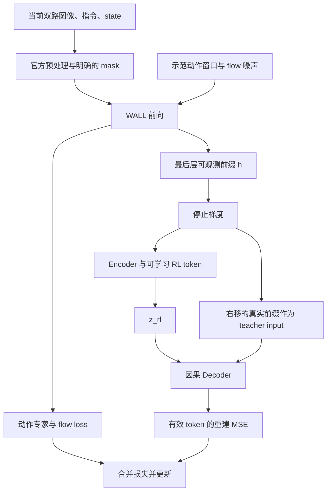
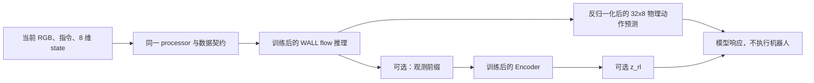

# WALL＋RLT 实现审阅说明

更新：2026-10-29。面向了解基本强化学习、深度学习并读过 RLT 文章的审阅者。

本文解释当前仓库的实现、设计选择和证据边界。项目当前进展以 [统一状态表](PROJECT_STATUS.md) 为准；操作安排见 [实施计划](WALL_RLT_Agent_Implementation_Plan.md)，原始字段依据见 [数据集格式说明](数据集格式说明.md)。已归档记录中的“推理入口暂缓”“GPU 型号未知”是旧状态；推理入口现已实现并完成候选打包，目标机信息见下文。历史日志和包内快照保留原貌。

本文本地相对链接面向完整项目工作区。部署工具包仅携带本项目源码、固定 WALL 快照和本轮报告，不包含完整 RLinf 工作树或所有历史日志；RLinf 引用使用固定 commit 的 GitHub 链接，离线审阅时可在开发工作区 `.cache/rlinf-rlt` 查找同一文件。

**Stage 1 训练代码、Stage 2 单步合成接口和模型侧推理工具已实现，最新 377 项 CPU 测试通过；三份候选包已写入 My Passport。尚无本项目训练后的 WALL＋RLT 权重，目标 GPU 完整训练／推理仍未验收，也没有在线 RL 收益或机械臂闭环结果。**

阅读时请始终区分三个层次：论文提出什么、仓库代码实现什么、我们实际运行验证了什么。以下“已实现”描述代码能力；只有明确列出运行证据的部分才表示已验证。

## 1. 整个项目当前在做什么

VLA 是 Vision-Language-Action model，即同时使用图像、语言指令和机器人状态预测动作的模型。本项目以 WALL-OSS-0.5 为 VLA 底座，为它增加一个读取内部表示的 RLT Encoder，然后准备把这个表示交给后续小型强化学习策略。

这里的“RL token”是**连续向量**，默认长度为 2048；它不是自然语言词、离散动作编号，也不是机器人控制指令。Encoder 是把多个输入表示编码为一个向量的网络；Decoder 是训练时用来检查这个向量保留了多少信息的重建网络。

| 部分 | 当前实现 | 已有证据 | 仍未完成 |
|---|---|---|---|
| 真实示范数据接入 | 350 条抓取轨迹、时间对齐、数据划分、归一化、官方预处理 | 原始数值字段和代表图像 batch 的 CPU 检查 | 全视频逐帧质量检查、逐条成功／失败标注 |
| Stage 1：监督适配与表示学习 | WALL 动作损失＋RLT 前缀重建损失；训练 worker、恢复接口 | 微型真实 WALL、RLT、梯度隔离和小模型恢复 | 完整底座训练、H100 FSDP 实跑、目标数据短训验收 |
| Stage 2：强化学习接口 | 冻结特征、动作空间转换、单步 transition、调用固定 RLinf Actor-Critic | 合成输入上的一次 Actor 和一次 Critic 更新 | 真实 replay、奖励闭环、在线训练和收益评测 |
| 推理部署工具 | 训练 checkpoint 导出、WALL＋Encoder 加载、观测请求和响应协议、离线构建工具；源码候选已打包 | CPU 微型模型与服务测试、整包校验及实际解包检查 | 训练后权重、5070 Ti 镜像构建与 GPU 检查、完整推理、显存／时延和重启验收 |

训练资源为用户确认的 **8 张 H100**；这表示服务器资源总量，不表示当前作业已经获得 8 张卡。当前双卡 FSDP 配置仍是候选。推理目标为 Ubuntu、RTX 5070 Ti 16GB、驱动 595.91.07，项目目录为 `/home/crp-5070ti-01/yuhang_workspace/wall_oss_rlt`，见 [目标主机配置](configs/inference/rtx5070ti.json)。

本机不连接 H100，不采集新数据，也不通过新增推理服务操作机器人。现有交付经过 My Passport 中转，由用户在目标主机执行部署和验证。

## 2. 论文机制、固定 RLinf 与本项目之间的关系

RLT 论文的关键机制是：用可学习 token 压缩 VLA 内部表示，通过带停止梯度的自回归重建学习该表示；随后冻结 VLA 和表示网络，训练以参考动作和 RL token 为输入的 Actor，并用 Critic 及参考动作约束进行改进。论文采用 π0.6；其固定指令实验省略语言 embedding，且 RL 执行块长度小于 VLA 预测长度。[论文第 IV 节](https://arxiv.org/html/2604.23073v2#S4)

官方介绍还强调，Actor 既接收参考动作，又被约束在参考动作附近；reference-action dropout 会随机去掉 Actor 输入中的参考动作，以降低直接照抄的倾向。这些机制属于完整在线阶段，单独训练 Encoder 并不会自动改进动作。[Physical Intelligence 的 RLT 介绍](https://www.pi.website/research/rlt)

本项目没有把整个 π0.6／OpenPI 系统替换进 WALL。我们复用固定版本 RLinf 的 Token 模块与 Actor-Critic 实现，再完成 WALL 自身的表示提取、数据和训练适配。

| 项目 | 固定 RLinf 的 OpenPI 路径 | 本项目 WALL 路径 |
|---|---|---|
| VLA 接入 | OpenPI 的 prefix／suffix 前向 | WALL 的 flow 训练和 vanilla flow prefill |
| 被重建的 token | 默认 `rlt_image_only=True`，选择图像部分 | 第一个 action token 之前的所有有效观测 token，包括图像、指令和当前 state |
| 有效位 mask | 配置默认 `rlt_use_mask=False` | 显式选择有效 token；Encoder、Decoder、loss 均使用 mask |
| 前缀容量 | 默认 768 | 默认上限 1024；不是每个样本都填满 1024 |
| 表示网络 | `RLTTokenTransformer` | 保留同一模块实现，放入项目 `_vendor` 并记录来源 |
| 动作数据 | OpenPI 对应环境的动作定义 | AR5 下一帧实测七关节角＋夹爪指令，另建明确的迁移变体 |
| 在线连接 | 上游有环境／rollout／replay 实现 | 本项目目前只验证单步接口和合成 AC 更新 |

可核对 [RLinf OpenPI RLT 配置](https://github.com/RLinf/RLinf/blob/e1a82ebf0c1af69da6ab9b1519f5f3692fe33566/rlinf/models/embodiment/openpi/rlt_config.py)、[OpenPI 接入代码](https://github.com/RLinf/RLinf/blob/e1a82ebf0c1af69da6ab9b1519f5f3692fe33566/rlinf/models/embodiment/openpi/pi0.py) 与 [项目 Token 模块](wall_rlt/_vendor/rlt_token_transformer.py)。这里“默认值”特指固定源码版本，不代表所有 RLT 实验配置。

固定版本为 Wall-X `ce2a1ae31d9ee1028b97ca40e3f66034cf8c0e5f`、WALL checkpoint `b7dc23a82dbf70a65859c9fdd596703234597028`、RLinf `e1a82ebf0c1af69da6ab9b1519f5f3692fe33566`。来源与文件哈希见 [源码锁文件](metadata/wall-rlt-sources.lock.json)。WALL 补丁放在隔离源码中；审阅运行行为时应查看 `.cache/wall-x-rlt` 和项目补丁，而不能只看未打补丁的 `wall-x`。

## 3. 数据：为什么必须先弄清时间和动作含义

### 3.1 选中的数据与划分

目标目录为 `/media/pangk/My Passport/top_error`。按用户要求排除 `mouse`、`tape`，忽略历史验证集。保留 banana、black_box、black_sleeve、charger、long_box、pill_box、water_bottle 七类，每类 50 条，共 **350 条轨迹、176,523 原始帧**。

episode 指一次连续记录的轨迹。数据按 episode 划分，避免同一条轨迹的相邻帧同时进入训练集和测试集：每类 35／7／8 条，对应 train／dev／test 共 **245／49／56 条**。每条最后一帧没有下一帧标签，因此监督任务共有 **176,173 个可用观测**。这些数字来自 [冻结清单](metadata/rlt-top-error-selected-20261029/episodes.json) 和 [CPU batch 报告](metadata/rlt-top-error-selected-20261029/cpu-batch.json)。

用户确认记录来自后续推理验证使用的主机和机械臂。这解决了数据来源问题；它本身不证明数据中每次抓取都成功，也不提供 RL 奖励。

### 3.2 三种容易混淆的“动作”

| 对象 | 内容 | 本实现怎样使用 |
|---|---|---|
| 原始 `state[t]` | 当前实测 j1～j7，单位 rad；第 8 维为实测夹爪开度 | 当前观测的一部分 |
| 原始 `action[t]` 前 6 维 | 从 `t-1` 到 `t` 的实测法兰位姿变化；位置单位 m，旋转为基座系左乘旋转向量 | 不直接作为当前时刻的未来关节动作标签 |
| 原始 `action[t,6]` | 二值夹爪指令：0 合、1 开 | 用下一帧的指令构造监督目标 |

首版目标 `ar5_joint_next_v1` 明确规定：

\[
o_t=(I_t^{\rm high},I_t^{\rm front},\ell,s_t),\qquad
a_t^*=[s_{t+1,0:7},\;a^{\rm raw}_{t+1,6}].
\]

也就是说，输入是当前图像、指令和状态，目标是**下一帧实测关节位置＋下一帧夹爪指令**。原始关节控制命令没有保存，因此这里学习的是示范中的状态演化目标，不能把它描述成恢复了当时实际下发的七关节命令。具体实现见 [aligned_targets](wall_rlt/data/ar5.py)。

例如夹爪接到“闭合”命令后，被物体挡住，实测开度可能仍为 0.38。`state` 中的 0.38 表示观测到的开度；监督动作里的 0 表示闭合意图，两者不能互换。

原始旋转增量满足 `R[t] · R[t-1]ᵀ`；旋转向量的三个分量不能直接相减来替代旋转组合。数据核验在 SO(3) 上比较旋转，SO(3) 是三维旋转矩阵组成的集合。本轮关节目标不需要把该旋转增量转换为关节命令，但保留这个核验能确认源数据的时间语义。

### 3.3 观测、窗口与有效位

WALL 每次预测长度 **H=32** 的 action chunk，即一整段未来动作。训练窗口从同一条 episode 内截取；临近末尾不足 32 步时补零，同时标记为无效。这里有两个不同的 mask：

- **时间 mask**：32 个时刻中，哪些有真实标签。
- **维度 mask**：26 个模型槽位中，哪些对应真实机器人维度。

补零只是组成规则张量的办法，不能让模型把补零当真实监督。项目把有效性传到 `flow_loss_mask`、`dof_mask` 和 attention 的有效动作位置；窗口不会跨 episode 接上下一条轨迹。见 [EpisodeWindowDataset](wall_rlt/data/dataset.py) 与 [WallCollator](wall_rlt/data/collator.py)。

### 3.4 归一化与预处理

归一化统计只由 train 中的 123,263 个对齐观测／目标计算。q01 和 q99 分别是每一维的 1% 与 99% 分位点，用来确定该维的典型数据范围。当前沿用 WALL 的分位数归一化与截断规则，目标版本、训练轨迹列表及统计文件通过哈希绑定。不能拿原始 7 维末端增量的统计去处理 8 维关节目标。

j3、j5 在这批遥操数据中近似不动。官方 normalizer 对零范围维度作保护，避免除零；反归一化使用保存的实际范围。**统计范围不等于机器人软限位，也不是未来 RL 的动作安全边界。**

图像使用两路 RGB：`cam_high` 是俯视，`cam_front` 实际是腕部相机。当前训练配置将长边按 448 缩放，再满足视觉 token 的尺寸要求；推理从保存的训练配置读取 `image_size` 与 `max_length`，防止训练、部署各用一套设置。state 使用官方 state-string 路径：归一化后按 512 个分箱编码到文本提示中；当前变体不使用额外连续 state 投影。分箱是把连续数值映射到有限区间编号，便于模型作为 token 读取。

数据契约 [top_error_ar5_joint_next_v1.json](configs/rlt/top_error_ar5_joint_next_v1.json) 保存字段顺序、单位、槽位、相机映射、时间对齐、划分及统计文件哈希。它是训练和推理共同遵守的机器可读定义。

## 4. 为什么动作投影必须重新初始化

原始 WALL 的动作槽位有末端位置、旋转等含义。即使它和当前任务都能装进 26 维张量，也不能把前七个槽位直接当七个关节角。**张量形状兼容不代表物理含义兼容。**

项目因此声明独立变体 `ar5_joint8_reinit_v1`：前 7 维为绝对关节角，第 8 维为夹爪指令，余下 18 维为无效槽位。输入 state 也使用对应的七关节与实测开度布局。

新迁移训练先加载底座的可复用权重，再重初始化两组参数：

| 参数 | 功能 | 形状 |
|---|---|---|
| `action_preprocessor.w1.weight` | 把动作数值及其维度 mask 映射到动作专家表示 | `[1024,52]`，52=26 个值＋26 个 mask |
| `action_preprocessor.action_proj_back.weight` | 把动作专家表示映射回 26 个输出槽位 | `[26,1024]` |

“重初始化”是重新给这些参数设置初始值，以便在新语义上训练，并不表示它们已经学会 AR5 控制。其余预训练结构继续提供迁移起点。恢复已训练 checkpoint 和加载推理产物时**不得再次重置**这两组参数，否则会丢掉已学到的映射。

实现见 [ar5_adapter.py](wall_rlt/model/ar5_adapter.py) 与 [builder.py](wall_rlt/model/builder.py)。builder 会严格核对底座参数形状，替换旧数据集 normalizer，并记录初始化报告；不靠裁剪或补齐权重掩盖不匹配。当前没有可用的训练后变体，因此仅有官方 WALL 权重还不能成为本项目 joint8 推理产物。

## 5. Stage 1：一条数据怎样经过两个训练分支

图中前缀 `h` 能看到哪些信息由 attention mask 决定。虽然动作标签和噪声也参与 WALL 的同一次训练前向，观测前缀不得读取未来动作。这个隔离条件需要测试，单凭图上的箭头或调用 `detach()` 不能证明。

### 5.1 取的是哪个“前缀”

prefix 在这里指 token 序列中第一个 flow action token 之前的有效观测部分。token 可以来自图像块、语言、当前状态和提示格式。项目不直接把 `moe_token_types==0` 当作前缀，因为它可能包含 padding 或其他不应选入的位置。

WALL 的 MoE 是 Mixture of Experts：不同类型 token 由不同专家模块处理。其 `mot_opt` 路径会先重排 token，再按专家计算。补丁从**恢复原 token 顺序后的最后层输出**提取前缀，保留每个样本的有效位，并将 padding 清零。

默认形状为 `h:[B,L,2048]`、`mask:[B,L]`。B 是 batch 样本数，L 是该批最长的有效前缀；真实数据代表样本约为 471～472 个 token，上限配置为 1024。动作专家宽度是 1024，不能把它误当成 RLT 输入的 2048。

训练路径显式传入 `mode='train'`。这是 WALL API 的特殊要求：仅调用 PyTorch 的 `.train()` 不足以选择有梯度的 WALL 前向。项目还启用 `flow_loss_only=True`，关闭文本／FAST 动作监督，用全 `-100` 的 labels 表示忽略文本标签，避免为无关目标计算巨大的全词表 logits。logits 是分类输出尚未经过 softmax 的分数。

源码入口：[前缀选择与打包](wall_rlt/model/prefix.py)、[Stage 1 wrapper](wall_rlt/model/policy.py)、[隔离 WALL 模型补丁后的源码](.cache/wall-x-rlt/wall_x/model/qact/qwen2_5/modeling_qwen2_5_vl_act.py)。

### 5.2 Encoder：一个可学习的读取位置

Encoder 在前缀尾部拼接一个可学习向量 `e_rl`，加入位置编码，再经过 Transformer：

\[
z_{\rm rl}=E_{\phi}([h_1,\ldots,h_L,e_{\rm rl}])_{L+1}.
\]

注意 `e_rl` 和 `z_rl` 不同：前者是训练参数，所有观测共用；后者是本次观测经过网络后得到的输出，所以会随图像、指令和状态变化。它相当于一个会学习“读取哪些信息”的汇总位置，而不是把 token 简单平均。

默认 `input_dim=embed_dim=2048`、Encoder 2 层、8 个 attention head、`mlp_ratio=4`、dropout=0。相等的输入／输出维度下，输入投影为恒等映射；可学习位置编码和 attention 仍参与训练。Encoder 输出 `[B,1,2048]`，接口展平为 `[B,2048]`。参数定义见 [WallRLTConfig](wall_rlt/config.py) 与 [RLTTokenEncoder](wall_rlt/_vendor/rlt_token_transformer.py)。

一个输出 token 不意味着网络很小。按当前真实模块在 meta device 上计数，Encoder 有 **371,286,016** 个参数，FP32 参数本身约 **1.383 GiB**；Decoder 有 **375,478,272** 个参数。当前 GeGLU 门控前馈层包含较大的线性矩阵，因此两者合计约 7.47 亿参数。这里的“小型在线策略”应指后续 Actor-Critic，不能把整个 Stage 1 训练网络的资源消耗忽略。

### 5.3 Decoder：teacher forcing 与因果重建

Decoder 是训练用重建网络，不是 WALL 的动作专家。若前缀只有三个 token，训练输入和目标关系为：

| 位置 | Decoder 输入 | 要预测的目标 |
|---|---|---|
| 1 | `z_rl` | `h1` |
| 2 | `h1` 的停止梯度副本 | `h2` |
| 3 | `h2` 的停止梯度副本 | `h3` |

这称为 **teacher forcing**：训练时提供真实的历史目标作为上下文，而不是用模型自己前一步的预测递推。**causal mask** 是因果遮罩，使位置 i 不能读取右侧位置；因此预测 `h2` 时可以看到 `z_rl,h1`，不能直接看到 `h2` 或 `h3`。训练时所有位置仍可在一次矩阵计算中并行处理。

重建目标是 VLA 的内部连续 embedding，不是原始 RGB 图像、词表 token，也不是未来动作。Decoder 的输出线性层把隐表示映射回 2048 维。输入 padding、右移后的 teacher padding 和损失 padding 分别处理，避免补齐项产生伪监督。

需要保留一个审阅上的限制：因果 Decoder 同时获得真实历史前缀，因此后续 token 的预测可以利用历史上下文。重建 MSE 很低说明当前条件重建任务做得好，**不能单独证明 `z_rl` 已保存所有信息，或足以解决后续控制问题**。未来可以比较置零／打乱 `z_rl` 后的重建变化、下游控制表现和其他特征基线；这些是待做实验，不是当前通过项。

### 5.4 停止梯度与两个损失

stop-gradient 在 PyTorch 中主要通过 `detach()` 实现：保留张量数值，但切断这条路径向前面的参数传播梯度。项目在 wrapper 和 Token 模块中都明确隔离 WALL 前缀，并用 FP32 计算 RLT 重建。

\[
L_{\rm rlt}=\frac{\sum_{b,i,d}m_{bi}(\hat h_{bid}-\operatorname{sg}(h_{bid}))^2}
{2048\sum_{b,i}m_{bi}},\qquad
L_{\rm total}=L_{\rm rlt}+\alpha L_{\rm vla},\quad \alpha=1.
\]

MSE 是均方误差；这里按有效 token 和特征维度平均。`L_vla` 是 WALL 自己的 flow 动作损失。flow matching 可理解为学习从噪声动作逐步走向示范动作的变换方向；训练拟合相应目标，推理再做数值积分。项目复用既有 WALL 方程和采样约定，没有另写一套去噪算法。

| 损失 | WALL 参数 | Encoder 参数 | Decoder 参数 |
|---|---|---|---|
| 动作 `L_vla` | 有直接梯度 | 无 | 无 |
| 重建 `L_rlt` | 无直接梯度 | 有 | 有 |

“联合训练”表示两个分支在同一个训练步骤内运行和优化。它不表示重建目标端到端改变 WALL。WALL 仍会被动作损失微调，所以 Encoder 在 Stage 1 学习的是随动作训练逐渐变化的内部表示。

**全局梯度裁剪使优化轨迹存在间接耦合。** 当前配置 `clip_grad=1.0`，RLinf 在整个模型上计算梯度范数。若总范数超限，会用同一个系数缩放 WALL 与 RLT 两部分的梯度。形式上可以写成 `c=min(1,τ/||[αg_wall,g_rlt]||)`。RLT 梯度变大可能让 WALL 梯度也被缩小。因此“重建对 WALL 没有直接梯度”是正确的；“加入 RLT 后 WALL 每一步必定与纯 SFT 完全一样”则不成立。源码见 [RLinf optimizer_step](https://github.com/RLinf/RLinf/blob/e1a82ebf0c1af69da6ab9b1519f5f3692fe33566/rlinf/hybrid_engines/fsdp/fsdp_model_manager.py)。

### 5.5 怎样检查没有把答案泄漏给 Encoder

项目已有测试分别扰动未来动作、flow 时间和噪声，检查同一当前观测的前缀不变；比较训练路径与推理 prefill 的前缀；扰动 padding 标签，检查有效损失不变；改变当前图像，检查特征确实会变化。还检查关闭新开关后与原 WALL 动作／损失一致。

这些测试中有真实 WALL 代码和视觉分支，但模型是小尺寸随机 fixture；fixture 指为检查程序行为专门构造的样例。它们证明接口和部分数学关系，不代表完整预训练模型在真实抓取上有效。见 [前缀集成测试](tests/rlt/test_prefix_integration.py)、[推理 runtime 测试](tests/rlt/test_inference_runtime.py)。

## 6. 训练工程：FSDP、精度和恢复

### 6.1 训练入口与配置

项目通过 RLinf 的外部注册机制注册 `wall_rlt`，由 [WallRLTSftWorker](wall_rlt/workers/sft.py) 接入数据 loader、验证和恢复状态。SFT 是 supervised fine-tuning，即用示范标签继续监督训练。这里不需要 reward model，也没有 PPO 的概率比更新；未支持的 PPO／logprob 入口会显式报错。

当前 [双卡候选](configs/rlt/stage1_2gpu.yaml) 为完整参数微调：micro batch=1、global batch=4、100 步短训、每 50 步保存、学习率 `2.5e-5`、10 步 warmup。micro batch 是每卡每次前后向的样本数，global batch 是一次优化更新累计使用的样本数。两卡时通过梯度累积保持有效 batch=4。

双卡配置关闭 dev 循环，因为当前项目验证逻辑只支持单 rank，避免分布式中重复样本或各卡前向次数不同。单卡配置的 64 窗口验证只是 smoke subset，不能当完整 dev 集指标；测试集不进入训练或统计计算。

### 6.2 为什么使用 FSDP

FSDP 是 Fully Sharded Data Parallel：将参数、梯度和优化器状态分散存储在多张 GPU 上，计算需要时再通信收集对应部分。它减少每卡常驻存储，但不会消除激活、通信缓冲区或临时权重的占用。

当前静态估计中，FP32 参数、梯度、Adam 一阶和二阶状态合计约 **73.15 GiB**；理想双卡分片后的常驻状态下界约 **36.57 GiB／卡**。这些数字没有包含激活、BF16 工作副本、通信、CUDA workspace、碎片等，不能作为“两张卡一定能跑”的结论。见 [静态资源报告](metadata/rlt-h100-memory-estimate-20261029.json) 和 [估算实现](wall_rlt/resources.py)。

只由 RLinf 负责 FSDP 包装。项目按 WALL 的真实 decoder／vision 层类型和 RLT 子树配置包装边界，避免同时调用另一个 WALL FSDP 入口而形成双重包装。服务器有 8 张 H100 并不自动改变候选的卡数、batch 或验证方式。

### 6.3 混合精度需要区分训练和推理

FP32 是 32 位浮点；BF16 是指数范围接近 FP32、有效位更少的 16 位格式。混合精度不是把整个模型机械地转换成 BF16，而是按计算路径选择不同类型。

训练候选保留 FP32 主参数，以 FSDP 策略配置 WALL 的 BF16 计算、FP32 梯度规约和 RLT 子树的 FP32 计算；RLT 调用还显式关闭外层 autocast。autocast 是自动选择部分运算精度的上下文。完整 WALL 的 GPU／FSDP 精度组合仍待实测，不能用 CPU 小模型结果替代。

推理导出则沿用 WALL 的选择性精度：大部分参数为 BF16，动作预处理／投影、normalizer、相关 layernorm 参数保留 FP32，Encoder 保留 FP32。原因很具体：WALL flow 路径把动作 hidden states 转成 FP32 再送入动作输出投影，若投影权重也被统一转换成 BF16，会出现类型不匹配。layernorm 是用来稳定特征尺度的归一化层，不能与数据 normalizer 混为一谈。

当前混合精度推理要求 `mot_opt=True`。复核发现上游 `mot_opt=False` 路径存在 QKV 写入的 Float／BF16 不匹配；loader 对未支持的配置提前拒绝。CPU 对应视觉 eager attention，目标 GPU 使用经验证构建后的 FlashAttention；本项目禁止与固定 WALL VisionBlock 接口不兼容的 vision SDPA 组合。

### 6.4 恢复训练要保存什么

checkpoint 是某个训练时刻的恢复快照。仅保存模型权重不足以精确续训，还需要优化器、学习率调度、随机数状态及数据读取位置。

项目补充保存 collator 的私有 NumPy 随机数状态、DataLoader generator、epoch／offset 和评估 collator 状态。原因是 flow 时间采样不只依赖全局 Torch RNG。RNG 是随机数生成器；恢复同一个 seed 并不自动恢复它已经产生了多少个数。

RLinf 训练 checkpoint 同时保留分布式状态和用于部署导出的 consolidated full weights。consolidated 表示已合成完整参数，不是某一张卡的分片。项目侧 `wall_rlt_data.json` 绑定训练 step、数据契约和资产哈希；`wall_rlt_assets/` 保存适配配置、processor、归一化、episode 清单与来源信息。

恢复入口区分 `new_transfer` 和 `resume`：后者构造同一结构，但未成功加载 checkpoint 前禁止前向，也不会重置 AR5 动作投影。当前恢复签名包含 world size 等设置，不承诺随意改变卡数后仍能逐步一致恢复。小模型独立进程恢复已检查；真实 H100 分片恢复尚未验收。见 [checkpoint 实现](wall_rlt/checkpoint.py)、[worker 保存／恢复](wall_rlt/workers/sft.py)、[恢复测试](tests/rlt/test_checkpoint.py)。

## 7. Stage 2：已接通的接口与还没有发生的学习

正式 reward、warmup、更新节奏、transition 与 chunk 设计由用户决定，当前未定版。下文描述已实现接口及合成检查，不把测试常数当作实验参数；具体状态与待定项见 [Stage 2 设计决策清单](WALL_RLT_Stage2_Design_Decisions.md)。

### 7.1 冻结后的输入

Stage 2 冻结 WALL 和 Encoder，设为 eval 模式。冻结指不更新这些参数；eval 则关闭训练专用行为。两者含义不同，需要同时满足。Decoder 不参与特征推理。

接口提供：

| 字段 | 意义 | 当前单步检查形状 |
|---|---|---|
| `z_rl` | 当前观测的压缩表示 | `[B,2048]`；微型测试用更小维度 |
| `proprio` | 机器人本体状态，如当前关节和夹爪状态 | `[B,8]` |
| `ref_chunk` | WALL 给出的参考动作，转换到 RL 动作空间 | `[B,1,8]` |

proprioception 意为本体感觉。此接口要求调用方提供一致的 state 表示；代码检查 shape 和有限性，不会自行推断控制边界或机器人几何关系。

**H=32 与 C=1 是不同概念。** H 是 WALL 一次预测的长度。C 是 RL transition 对应的实际执行长度；当前项目只检查 C=1 的单步接口，`extract_rlt_obs` 取 WALL 参考块的第一步。推理服务返回的 32 步输出不等于已经实现了 32 步 RL replay，更不表示机器人应开环执行全部 32 步。

### 7.2 Actor、Critic 和参考动作约束

Actor 是产生动作的策略网络；Critic 是估计“这个状态采取这个动作，未来能获得多大回报”的价值网络。固定 RLinf `RLTMLPPolicy` 的 Actor 输入为 `ref_chunk + z_rl + proprio`，Critic 输入为 `z_rl + proprio + 待评估动作`。

Actor 直接产生完整动作提案，代码没有强制采用“WALL 动作＋残差”的加法结构。它使用固定标准差的高斯采样，再经 `tanh` 压到 `[-1,1]`。项目显式用 [BoundedActionTransform](wall_rlt/data/transforms.py) 将已声明范围的物理动作与 RL 动作相互转换；超界会报错，不进行无记录的限幅。

固定 RLinf 当前 Actor 目标可概括为：

\[
L_{\rm actor}=-w_Q\,\mathbb E[Q(x,\pi(x,\tilde a))]
+w_{\rm BC}\,L_{\rm BC}(\pi,\tilde a).
\]

BC 是 behavioral cloning，这里对应参考动作附近的拟合／约束项；支持的人工干预分支还可以使用明确记录的干预动作。`reference_dropout_prob` 控制 Actor 输入中的参考动作随机置零。当前合成检查未启用该 dropout，不能将“代码支持”写成“本项目已验证其收益”。

上游类和函数中仍有 `SAC` 命名，但这版 RLT AC 不做熵温度 alpha 学习；`forward_alpha` 明确拒绝该操作。不能把日志中的 entropy 指标自动理解为执行了完整的 SAC 熵优化。这里的熵温度 alpha 也不同于 Stage 1 的 `rlt_alpha` 动作损失系数。源码见 [RLTMLPPolicy](https://github.com/RLinf/RLinf/blob/e1a82ebf0c1af69da6ab9b1519f5f3692fe33566/rlinf/models/embodiment/mlp_policy/rlt_mlp_policy.py) 和 [RLTACLossMixin](https://github.com/RLinf/RLinf/blob/e1a82ebf0c1af69da6ab9b1519f5f3692fe33566/rlinf/workers/actor/fsdp_rlt_ac_policy_worker.py)。

### 7.3 为什么现有抓取数据还不是 RL replay

replay buffer 是保存实际交互 transition 以便重复学习的经验库；off-policy 表示可使用由其他策略或人类行为产生的经验。正确 transition 至少要有当前观测、实际动作、奖励、下一观测及终止语义。

目前示范没有可靠的 reward／terminated／truncated 字段，也未保存原始关节控制命令。不能把下一帧实测关节标签标记为已执行动作，也不能凭抓取文件名补造成功奖励。

当前 [single_step_transition](wall_rlt/stage2.py) 因而要求显式来源和执行／奖励／终止证据，并区分：

- `terminated`：任务或环境真正终止，标准 TD target 停止 bootstrap。
- `truncated`：例如时间上限截断；若任务本身未终止，标准语义通常仍可从终止前的下一状态估值。
- `auto_reset`：环境结束后自动返回了新一局观测；此时必须另提供 reset 之前的 `final_obs`，不能拿新一局状态当旧轨迹的下一状态。

bootstrap 指用 Critic 对后续状态的估值补足尚未观察到的回报。当前 C=1，时间间隔要求约 `1/30 s`，target 使用一步折扣；上游按 reward 张量宽度计算折扣长度。因此把补齐到 32 步的奖励数组直接当真实执行块，会错误改变折扣和目标。

已通过的合成检查执行真实固定 RLinf loss，确认 Actor／Critic 各更新一次、输入特征和 target network 保持不变；没有使用训练后的 WALL Encoder，没有读取真实 replay，没有在线学习。target network 是用于构造稳定训练目标的参数副本；该检查不覆盖完整的长期更新调度。证据见 [Stage 2 合成报告](metadata/rlt-stage2-synthetic-20261029.json)。

## 8. 当前推理部署到底输出什么

服务实现中的动作来源明确为 `WALL_reference_prediction`。请求 `return_features=True` 时附带 `z_rl`，但 z 没有反馈进 Actor 改写动作。**请求特征与不请求特征，在相同输入和 seed 下应得到相同 WALL 动作。** Stage 1 推理导出物按实现仅包含 WALL 与 Encoder 权重，不包含训练 Decoder、Actor、Critic 或优化器；当前已交付的是源码工具包，真实训练权重尚未导出。

输入只允许当前指令、8 维状态和两路 RGB 图像，不接受示范 action、未来状态或动作标签。响应给出 `[32,8]` 动作；关节维度单位为 rad，夹爪维度仍是对二值训练目标的连续预测，不会在服务内自动阈值化为开合命令。机器人执行状态明确为 false。

WALL `generate_flow_action` 已经完成动作反归一化，runtime 只从 26 个槽位选出前 8 个。若再按统计做一次反归一化，会破坏输出单位。Stage 2 的 `[-1,1]` 转换属于另一层接口，不用于此物理动作响应。

flow 推理包含随机噪声。服务使用锁串行保护模型 cache、processor 和随机数；给定 seed 时保存／恢复 RNG 状态。固定 seed 的重复和重启结果按声明容差比较，不能据此承诺跨 GPU、跨库版本逐位相同。

服务健康元数据支持记录末次模型推理耗时，以及 CUDA allocator 的 peak allocated／reserved：前者是张量实际占用峰值，后者包括分配器保留的内存。峰值覆盖当前进程加载模型及其后的推理，不是单次请求的增量；CPU 检查对应字段为空。目标 GPU 数据尚未实测，模型耗时与客户端测得的 HTTP 总耗时应分别解释。

回放报告保存请求前后的 health 元数据，推理后的显存／耗时取 `metadata_after`，避免只读取尚未运行模型时的空值。报告对实际发送的 RGB 像素、图像大小、state 和指令计算 observation SHA256；episode／frame 编号相同并不足以证明输入相同。重启比较要求 artifact、契约、观测内容、运行设置、seed 和容差一致，同时要求 `server_instance_id` 改变。这个 UUID 是每次服务实例随机生成的标识，用来避免把同一进程中的重复请求误记为重启恢复测试。报告写到产物目录之外，保留原始包的完整性。

模型侧入口见 [runtime.py](wall_rlt/inference/runtime.py)；请求／响应定义见 [protocol.py](wall_rlt/inference/protocol.py)，服务与客户端分别在 [server.py](wall_rlt/inference/server.py)、[client.py](wall_rlt/inference/client.py)。既有数据回放检查见 [check_wall_rlt_inference.py](scripts/check_wall_rlt_inference.py)。

## 9. 从训练 checkpoint 到可搬运推理产物

artifact 是有明确内容和版本身份的部署产物。当前导出从 RLinf actor checkpoint 下的 `model_state_dict/full_weights.pt` 读取完整训练权重，再拆出 WALL 与 Encoder。

导出要求训练 step 至少为 1、训练元数据完整、资产哈希全部匹配、数据契约一致。加载使用 `weights_only=True`、CPU 和 mmap；mmap 是内存映射读取，可降低一次性复制大文件的压力，但不表示加载过程没有内存成本。未合并的分片、缺少元数据、错误 encoder 结构、非有限权重以及精度转换溢出会拒绝导出。

| 产物文件 | 用途 |
|---|---|
| `wall.safetensors` | 去掉 wrapper 前缀后的 WALL 参数，采用选择性 BF16／FP32 |
| `encoder.safetensors` | 仅 Encoder 参数，FP32 |
| `assets/adapted_wall_config.json` | AR5 变体结构，加载时不能换回原始末端配置 |
| `assets/rlt_config.json` | Encoder 结构及前缀／动作维度 |
| `assets/data_contract.json`、`normalization.json`、`episodes.json` | 字段、统计与训练数据来源绑定 |
| `assets/processor/`、训练配置、来源哈希与构建记录 | 重建相同预处理，并追溯训练来源 |
| `manifest.json` | 文件大小／SHA256、训练 step、契约指纹、artifact_id 和验证状态 |

safetensors 是专门存储张量的格式；导出不带 optimizer，也不把 Decoder 参数交给推理 loader。原 checkpoint 保持不变，输出必须是新目录，并拒绝路径逃逸和符号链接。数据根路径可改为产物内相对位置；数据契约的语义指纹保持不变，所以搬到另一主机不要求存在原移动硬盘路径。

artifact_id 由绑定的文件清单与关键元数据计算；哈希用于发现内容不一致，不能证明训练质量或作者身份。产物始终注明 `CANDIDATE_NOT_TARGET_VALIDATED`。目标机验收报告另行绑定同一个 artifact_id，不通过修改旧 manifest 冒充验收完成。

loader 在 meta device 上构造空参数结构，再用 strict assign 装入实际权重；meta device 只描述张量形状，不分配完整参数存储。RoPE 位置编码所需非持久 buffer 在 CPU 正常初始化，之后移动到目标设备。严格加载检查完整模型的参数名和形状，保留必要的 tied embedding／head 共享关系，并确认不存在未物化参数。它不从底座补随机参数，也不重新初始化动作投影。

生产加载还把 16 个实际模型／预处理源文件与训练记录中的 `source_hashes.json` 比较。这样既核对权重和配置，也核对它们被什么实现解释；新增服务代码和只用于训练的 worker 不参与这组精确比较，交付源码仍由单独的文件清单绑定。

导出中人工构造的测试 checkpoint 会保留 `purpose=synthetic`；生产 loader 拒绝此类产物。即使测试 fixture 为检查接口写入了一个非零 step，也不会被当成真实训练结果。实现见 [artifact.py](wall_rlt/inference/artifact.py)、[导出 CLI](scripts/export_wall_rlt_inference.py) 与 [产物测试](tests/rlt/test_inference_artifact.py)。

## 10. 5070 Ti 部署为什么仍需要目标机验收

目前已有官方 WALL 底座，可以先做官方模型的 baseline smoke，即检查环境能否加载并完成最小前向。这个结果验证基础模型和环境，不能替代训练后的 AR5 joint8＋Encoder 验收。

目标卡需要 `sm_120` 原生扩展。既有 D0 包构建面向其原验证环境，不能因为“都是 NVIDIA GPU”就认定其中的 WALL 原生扩展和 FlashAttention 能用于 5070 Ti。离线构建工具与源码候选已打包；下一步由用户在目标机从 D0 派生并重编扩展，目标构建尚未验收。驱动版本不在本轮修改范围；`nvidia-smi` 展示的 CUDA 能力上限也不等于容器实际安装的 CUDA Toolkit 版本。

原 D0 交付仍记录 11 项依赖声明问题；其整包完整性和组件检查通过不代表 `pip check` 已通过，也不代表新增训练或目标 GPU 推理依赖已验收。原记录见 [服务器环境交付](logs/server-environment-delivery-20261029.json) 与 [环境文档](environment.md)。

相关入口为 [目标机检查](scripts/check_wall_rlt_inference_host.py)、[离线源码工具包](scripts/package_wall_rlt_inference.py)、[目标构建脚本](docker/build_inference5070.sh) 和 [Dockerfile](docker/Dockerfile.inference5070)。工具包与训练后推理 artifact 是两种不同产物；前者不包含新训练出来的权重。

16GB 是否足够必须实测。除 WALL 和 FP32 Encoder 参数之外，还需视觉激活、KV cache、flow 中间张量、CUDA workspace 和内存分配器预留；删掉训练 Decoder／optimizer 可以降低占用，但不能据此直接保证可运行。

完整验收至少需要同一版本的训练权重和资产，并记录：模型加载、已有观测到 `[32,8]` 动作及 z 的前向、有限性／单位／相机顺序、峰值显存、冷启动与预热后时延，以及新进程重启后的固定输入比较。预测 32 步约覆盖 1.07 秒的示范时间，不等于模型已达到 30Hz 闭环控制频率。

## 11. 审阅时应怎样看待现有证据

本轮 [CPU 汇总报告](logs/rlt-inference-20261029/cpu-check/report.json) 记录 **377 项测试通过，0 失败、0 错误、0 跳过**；源码锁核验、训练入口预检和合成 Stage 2 更新也通过。该运行禁止 CUDA，不代表目标 GPU 验收。

| 证据层次 | 当前可追溯材料 | 能支持的结论 | 不能据此声称 |
|---|---|---|---|
| 原始数据与契约 | [数据审计](metadata/rlt-top-error-selected-20261029/audit.json)、[CPU batch](metadata/rlt-top-error-selected-20261029/cpu-batch.json) | 已选数据的字段、对齐和代表 batch 可用 | 350 条均抓取成功、全视频完整质量验收 |
| 训练代码的 CPU 检查 | [历史 CPU 报告](logs/rlt-cpu-check-20261029/report.json)、[后续准备检查](logs/rlt-h100-preparation-20261029/cpu-check/report.json) | 指定版本的单元／微型集成行为通过 | 全尺寸底座、H100 混合精度／FSDP 已通过 |
| 恢复 | [checkpoint 测试](tests/rlt/test_checkpoint.py) | 小模型独立进程状态恢复 | 实际分布式分片恢复、任意卡数恢复 |
| Stage 2 | [合成 AC 报告](metadata/rlt-stage2-synthetic-20261029.json) | 一次真实上游 AC loss／参数更新可执行 | 真实奖励学习、抓取成功率提高 |
| 推理实现 | [runtime 测试](tests/rlt/test_inference_runtime.py)、[协议测试](tests/rlt/test_inference_protocol.py)、[服务测试](tests/rlt/test_inference_service.py)、[产物测试](tests/rlt/test_inference_artifact.py) | 对应测试用例覆盖导出、加载、输入输出和错误处理 | 5070 Ti 实测 PASS 或真实训练权重有效 |
| 部署主机 | [本机检查记录](logs/rlt-inference-host-local-20261029.json)、[目标配置](configs/inference/rtx5070ti.json) | 本机构建背景与用户提供的目标信息已记录 | 已在目标主机运行完整模型 |

历史 [实现快照](metadata/rlt-implementation-20261029.json) 记录的是当时 147 项 CPU 测试及对应文件哈希。后来新增的推理测试不能自动归入这份旧快照；审阅测试数量时，应查看当次运行报告及其源码版本。源码中存在测试用例也不等于在目标环境执行过该用例。

本轮统一检查报告入口为 [推理实施 CPU 检查](logs/rlt-inference-20261029/cpu-check/report.json)。具体通过项和数量以该次运行报告为准，不将其解释成目标 GPU 验收。

后续评测至少需要分别报告纯 WALL SFT、Stage 1 后仅使用 WALL 动作、以及真正接入训练后 Actor 的 WALL＋RLT。比较时控制数据划分、初始化、训练步数、动作定义和随机种子，并记录前述全局梯度裁剪因素。Stage 1 重建损失降低、输出形状正确和随机 fixture 服务可运行，都不是在线收益证据。

当前最需要人类审阅的判断有三项：下一帧实测关节目标是否适合作为预期控制接口的学习代理；完整观测前缀压缩是否保留了下游任务所需信息；后续真实交互如何提供可追溯的执行动作、奖励与终止状态。这三项分别对应数据建模、表示质量和 RL 闭环，不能由一条 loss 曲线统一回答。

## 12. 术语速查与代码阅读顺序

| 术语 | 在本文中的具体意思 |
|---|---|
| VLA／backbone | 图像、语言、动作模型／其主要预训练网络 |
| embedding／hidden state | 网络内部的连续特征向量；不同层或不同 token 对应不同表示 |
| prefix／prefill | 可观测 token 前缀／推理中首次处理完整上下文并建立 cache 的计算 |
| RL token／`z_rl` | Encoder 最后一个读取位置的输出向量，不是动作 |
| bottleneck | 用较小输出表示承载大量输入信息的结构约束；不等于信息完整性保证 |
| teacher forcing | 用真实历史目标辅助预测后续目标的训练方式 |
| causal mask／padding mask | 禁止读取未来位置／禁止读取补齐位置的遮罩 |
| detach／stop-gradient | 保留数值但阻断该路径的梯度传播 |
| flow matching | 学习噪声与动作之间变换的训练方法；推理需迭代积分 |
| action chunk／H／C | 连续动作段／VLA 预测长度／RL transition 的执行长度 |
| Actor／Critic／Q | 动作策略网络／价值评估网络／状态动作价值 |
| reference action | WALL 的动作提案，用于条件输入与约束，不是示范真值 |
| replay／off-policy | 可复用的交互经验库／可利用其他行为策略数据的学习方式 |
| bootstrap／target network | 用下一状态估值补足回报／用于稳定目标的网络副本 |
| FSDP／rank／world size | 分片数据并行／某个分布式进程编号／参与进程数 |
| FP32／BF16／autocast | 浮点格式／较低精度浮点格式／按算子自动选择精度 |
| checkpoint／artifact | 训练恢复快照／供部署和校验的版本化产物 |
| hash／fingerprint | 内容摘要／对语义配置计算的摘要，用于检查是否一致 |
| smoke／fixture | 小范围可运行性检查／专门构造的测试样例 |

建议按以下顺序阅读实现，先把语义和计算图串起来，再检查分布式与部署细节：

1. [数据契约](configs/rlt/top_error_ar5_joint_next_v1.json) → [时间对齐](wall_rlt/data/ar5.py) → [预处理](wall_rlt/data/collator.py)。
2. [动作适配](wall_rlt/model/ar5_adapter.py) → [builder](wall_rlt/model/builder.py) → [前缀提取](wall_rlt/model/prefix.py)。
3. [Stage 1 wrapper](wall_rlt/model/policy.py) → [Encoder／Decoder](wall_rlt/_vendor/rlt_token_transformer.py) → [梯度与前缀测试](tests/rlt/test_prefix_integration.py)。
4. [训练 worker](wall_rlt/workers/sft.py) → [双卡候选](configs/rlt/stage1_2gpu.yaml) → [checkpoint](wall_rlt/checkpoint.py)。
5. [Stage 2 transition](wall_rlt/stage2.py) → 固定 RLinf 的 Actor-Critic → [合成证据](metadata/rlt-stage2-synthetic-20261029.json)。
6. [推理导出](wall_rlt/inference/artifact.py) → [runtime](wall_rlt/inference/runtime.py) → [协议](wall_rlt/inference/protocol.py) → [回放验收入口](scripts/check_wall_rlt_inference.py)。
